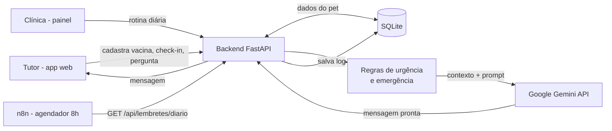
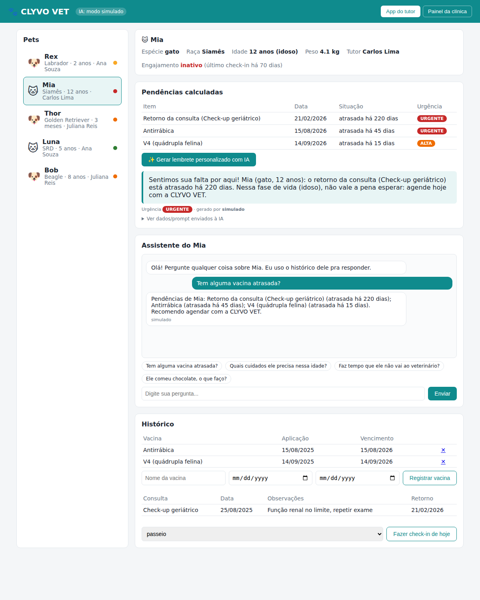
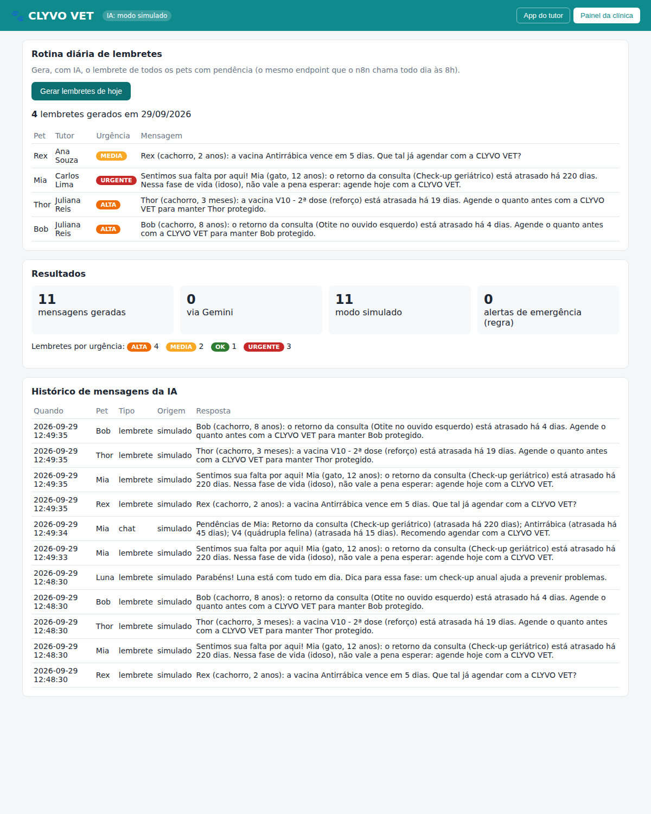

# CLYVO VET - IA de cuidado contínuo do pet

Projeto da disciplina **Disruptive Architectures: IoT, IoB & Generative IA** - Challenge Pet, Sprint 4.

O CLYVO VET é uma plataforma de cuidado contínuo do pet. Ela resolve três problemas: o tutor esquece consulta e vacina, a clínica perde o vínculo com o tutor depois da primeira visita, e não existe um histórico estruturado do pet ao longo do tempo.

Nesta sprint a solução de IA definida na entrega anterior ([docs/IA-CLYVOVET-sprint3.md](docs/IA-CLYVOVET-sprint3.md)) foi **implementada e integrada** a uma aplicação funcional: backend, banco de dados, API de IA generativa (Google Gemini) e interface web para o tutor e para a clínica.

**Vídeo pitch (Sprint 4):** _COLAR LINK DO YOUTUBE (NÃO LISTADO) AQUI_

## O que a IA faz

| Funcionalidade | Como funciona |
|---|---|
| **Lembrete personalizado** | Lê os dados do pet no banco, calcula a pendência mais urgente e pede ao LLM uma mensagem adaptada à espécie, idade, fase de vida, urgência e engajamento do tutor. |
| **Assistente do pet (chat)** | O tutor pergunta; a pergunta vai ao LLM junto com o histórico do pet, e a resposta usa esses dados. |
| **Regra de urgência** | Regras determinísticas classificam cada pendência (urgente / alta / média / baixa) **antes** do LLM. A IA escreve o texto, mas quem decide o que é urgente é o código, o que evita "alucinação" de datas. |
| **Detecção de emergência** | Perguntas com palavras como "convulsão", "veneno" ou "chocolate" recebem uma orientação imediata de ir ao veterinário, sem passar pelo LLM. |
| **Rotina diária para a clínica** | Um endpoint gera os lembretes de todos os pets com pendência. Pode ser chamado todo dia por um fluxo do **n8n** (incluso). |
| **Modo simulado** | Sem chave de API (ou se o Gemini falhar), o sistema usa textos modelo, e a demonstração nunca quebra. |

Exemplo real de saída para a gata Mia (12 anos, tutor sem check-in há 70 dias):

> Sentimos sua falta por aqui! Mia (gato, 12 anos): o retorno da consulta (Check-up geriátrico) está atrasado há 220 dias. Nessa fase de vida (idoso), não vale a pena esperar: agende hoje com a CLYVO VET.

## Arquitetura



Fluxo de uma mensagem:
1. `carregar_pet()` busca pet, tutor, vacinas, consultas, medicamentos e check-ins no banco.
2. `calcular_pendencias()` classifica o que está vencido ou vencendo por urgência.
3. `montar_contexto()` transforma esses dados num bloco de texto; `prompt_lembrete()` ou `prompt_chat()` monta o pedido com o tom certo.
4. `chamar_gemini()` envia para a API com uma instrução de sistema: não inventar dados, não receitar e sempre encaminhar sintomas ao veterinário.
5. A resposta é salva na tabela `mensagens_ia` (auditoria e métricas) e exibida na tela.

## Tecnologias

- **Python 3.11 + FastAPI** - API REST
- **SQLite** - banco de dados (tutores, pets, vacinas, consultas, medicamentos, check-ins, mensagens da IA)
- **Google Gemini API** (`gemini-3.8-flash`) - IA generativa (LLM)
- **HTML + CSS + JavaScript** - interface do tutor e painel da clínica
- **n8n** - automação da rotina diária de lembretes (opcional)
- **pytest** - testes automatizados

## Estrutura do repositório

```
clyvovet-ia/
├── app/
│   ├── main.py          # rotas da API e integração banco <-> IA
│   ├── ia.py            # prompts, chamada ao Gemini e modo simulado
│   ├── urgencia.py      # regras de urgência, fase de vida, engajamento e emergência
│   ├── database.py      # schema SQLite e dados de exemplo
│   └── static/index.html
├── tests/               # testes das regras e da API (inclui Gemini mockado)
├── n8n/lembrete-diario.json
├── docs/
│   ├── IA-CLYVOVET-sprint3.md   # definição da IA (entrega anterior)
│   ├── roteiro-video.md
│   └── prints/
├── requirements.txt
└── .env.example
```

## Como rodar

```bash
# 1. Instalar dependências
python -m venv .venv
.venv\Scripts\activate          # Windows  (Linux/Mac: source .venv/bin/activate)
pip install -r requirements.txt

# 2. (Opcional) Ativar a IA real
copy .env.example .env          # Linux/Mac: cp .env.example .env
# Cole sua chave gratuita de https://aistudio.google.com/apikey em GEMINI_API_KEY

# 3. Subir a aplicação
uvicorn app.main:app --reload
```

Abra **http://localhost:8000**. O banco é criado sozinho com 5 pets de exemplo. Documentação interativa da API: **http://localhost:8000/docs**.

Para zerar o banco: `python -m app.database`.

### Rodar os testes

```bash
pytest -v
```

### Fluxo n8n (opcional)

No n8n, *Import from file* → `n8n/lembrete-diario.json`. O fluxo chama `/api/lembretes/diario` todo dia às 8h e separa uma notificação por pet. O último nó pode ser trocado por WhatsApp, e-mail ou Telegram. Se o n8n não estiver em Docker, troque `host.docker.internal` por `localhost`.

## Endpoints principais

| Método | Rota | Descrição |
|---|---|---|
| GET | `/api/pets` | Lista pets com urgência calculada |
| GET | `/api/pets/{id}` | Detalhe do pet + histórico + engajamento |
| GET | `/api/pets/{id}/pendencias` | Pendências ordenadas por urgência |
| POST | `/api/pets/{id}/lembrete` | **Gera lembrete com IA** |
| POST | `/api/pets/{id}/chat` | **Assistente com IA** (`{"pergunta": "..."}`) |
| POST | `/api/pets/{id}/vacinas` | Registra vacina |
| POST | `/api/pets/{id}/checkin` | Registra check-in do tutor |
| GET | `/api/lembretes/diario` | Lembretes de todos os pets (usado pelo n8n) |
| GET | `/api/metricas` | Total de mensagens por origem e urgência |

## Testes e validação

17 testes automatizados (`pytest`), cobrindo:
- regras de urgência de vacina (vencida há mais de 30 dias, vencida, vencendo em 7 ou 30 dias)
- fase de vida por espécie (gato é idoso a partir de 10 anos, cachorro a partir de 8)
- tutor inativo após 30 dias sem check-in
- ordenação das pendências
- detecção de emergência sem chamar o LLM
- registro de vacina resolvendo a pendência
- **integração com o Gemini** com resposta HTTP simulada (confere a chave no header e os dados do pet no prompt)
- **fallback**: se o Gemini falhar, o sistema responde em modo simulado
- **retry e modelo reserva**: se o Gemini estiver sobrecarregado (503/429), o sistema tenta de novo e depois usa outro modelo Gemini disponível

Cenários de uso cobertos pelos dados de exemplo:

| Pet | Cenário | Urgência |
|---|---|---|
| Rex (cachorro, 2 anos) | Antirrábica vence em 5 dias | média |
| Mia (gata, 12 anos) | Retorno geriátrico e vacinas atrasadas; tutor inativo | urgente |
| Thor (filhote, 3 meses) | 2ª dose da V10 atrasada | alta |
| Luna (gata, 5 anos) | Tudo em dia (mensagem de parabéns + dica) | ok |
| Bob (cachorro, 8 anos) | Retorno de otite atrasado | alta |

## Resultados

- Solução de IA definida na Sprint 3 **implementada e integrada** (interface ↔ API ↔ banco ↔ LLM).
- Mensagens personalizadas por espécie, idade, fase de vida, urgência e engajamento do tutor, em vez de um aviso genérico.
- Regra de urgência (o "plus" da Sprint 3) implementada, além da camada de segurança para emergências.
- Todas as mensagens ficam registradas (`/api/metricas` e aba *Painel da clínica*), o que permite acompanhar o uso da IA.




## Equipe

- Artur Pioli Silva - RM565597
- Matheus Arazin de Oliveira - RM556649
- Kevin Martins Campos - RM563454
- Pedro Gabriel Claes - RM566058
